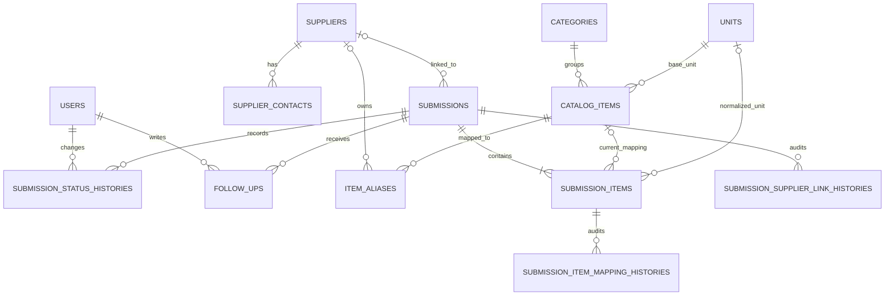

# Skema Database

Migration Laravel adalah sumber utama perubahan schema. File [`database/schema.sql`](../database/schema.sql) merupakan hasil dump struktur MySQL 8.4 setelah seluruh migration Phase 2 dijalankan dan disediakan sebagai artefak penugasan.

## Relasi domain



## Pembagian data

- **Master internal:** `units`, `categories`, dan `catalog_items` menjadi acuan barang yang rutin dibeli PT KDI.
- **Identitas supplier:** `suppliers` menyimpan perusahaan terkini dan `supplier_contacts` menampung lebih dari satu sales untuk perusahaan yang sama.
- **Bukti penawaran:** `submissions` dan `submission_items` menyimpan snapshot identitas, nama barang, satuan, harga, pajak, MOQ, serta lead time saat penawaran diterima.
- **Review procurement:** `item_aliases` menyimpan mapping yang dapat digunakan kembali. Tabel history menyimpan perubahan status, pengaitan supplier, dan mapping barang. `follow_ups` menyimpan tindak lanjut internal.

## Keputusan integritas data

- Submission baru selalu menjadi record baru; penawaran lama tidak ditimpa.
- Snapshot tetap dapat dibaca ketika master supplier, kontak, atau katalog berubah.
- Item dan aktivitas procurement dihapus secara cascade hanya ketika submission induknya dihapus.
- Referensi history ke user, supplier, katalog, atau satuan memakai `SET NULL`, sehingga audit record tetap ada jika master terkait dihapus.
- Kategori dan satuan yang masih dipakai katalog memakai `RESTRICT` untuk mencegah master aktif terhapus tanpa sengaja.
- NPWP supplier unik setelah normalisasi. Nilai `NULL` tetap diperbolehkan agar supplier tanpa NPWP dapat masuk ke tahap review manual.
- Nomor baris unik dalam satu submission dan kode master bersifat unik untuk menjaga konsistensi input.

## Data awal

`DomainCatalogSeeder` menyediakan 6 satuan, 4 kategori, dan 8 contoh barang. Seeder memakai `updateOrCreate`, sehingga aman dijalankan berulang kali dan dapat diperbarui tanpa menghasilkan duplikasi.

Untuk membangun ulang database beserta data awal melalui Docker:

```bash
docker compose exec -T app php artisan migrate:fresh --seed
```
